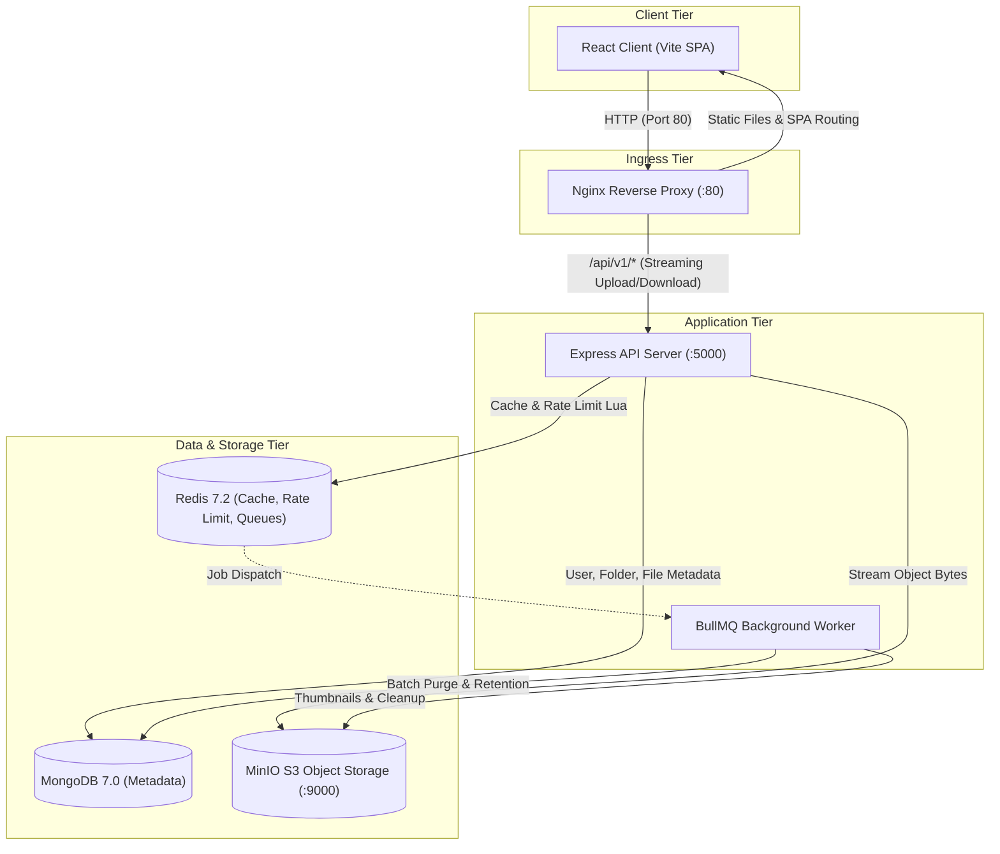

# DriveScale — Self-Hosted Cloud File Storage Platform

[](#testing-instructions)
[](https://www.typescriptlang.org/)
[](https://nodejs.org/)
[](https://react.dev/)
[](https://www.docker.com/)
[](LICENSE)

DriveScale is a modern, high-performance, self-hosted cloud file storage platform inspired by Google Drive and Dropbox.

Designed and engineered from the ground up as a production-grade **modular monolith**, DriveScale demonstrates modern full-stack TypeScript architecture, zero-in-memory-buffering streaming uploads, self-hosted MinIO object storage, distributed Redis caching, atomic rate limiting, BullMQ background job processing, and containerized deployment behind an Nginx reverse proxy—**completely free of AWS or proprietary cloud dependencies**.

---

## Table of Contents

1. [Project Overview](#1-project-overview)
2. [Implemented Features](#2-implemented-features)
3. [System Architecture](#3-system-architecture)
4. [Technology Stack](#4-technology-stack)
5. [Repository Structure](#5-repository-structure)
6. [Local Development Setup](#6-local-development-setup)
7. [Environment Variables](#7-environment-variables)
8. [Docker Production Deployment](#8-docker-production-deployment)
9. [API Overview](#9-api-overview)
10. [Upload Subsystem Architecture](#10-upload-subsystem-architecture)
11. [Database Schema & Metadata](#11-database-schema--metadata)
12. [User Interface & Screenshots](#12-user-interface--screenshots)
13. [Testing Instructions](#13-testing-instructions)
14. [Future Roadmap](#14-future-roadmap)
15. [Documentation Index](#15-documentation-index)

---

## 1. Project Overview

### What is DriveScale?
DriveScale gives individuals and organizations private, sovereign cloud storage. It replicates the core user experience of commercial platforms (Google Drive, Dropbox, Box) while running entirely on self-hosted infrastructure.

### The Problem It Solves
Public cloud storage providers charge steep recurring fees, bill unpredictably for egress bandwidth, and retain custodial access over private data. Traditional self-hosted solutions are often monolithic legacy PHP applications that are cumbersome to maintain, difficult to scale, or lack resilient resumable upload handling. DriveScale provides a modern, fast, TypeScript-native alternative that deploys effortlessly with Docker.

### Why MinIO Instead of AWS S3?
DriveScale enforces a strict **zero-AWS dependency** mandate. Object storage is powered by **MinIO**, an open-source, S3-compatible object store deployed locally inside the Docker Compose cluster:
- **Zero Cloud Egress Fees**: Transfer terabytes of data across internal networks without per-gigabyte bandwidth surcharges.
- **Data Sovereignty**: File bytes remain strictly on self-hosted disks or private storage volumes.
- **S3 API Compatibility**: All object storage access is abstracted through `IStorageService`, enabling seamless migration to any S3-compliant target if desired without touching business logic.

### Core Architectural Goals
- **Separation of Bytes & Metadata**: MongoDB stores relational metadata, folder trees, and permissions; MinIO stores file bytes under randomized, sharded keys (`objects/xx/<hash>`).
- **Zero Whole-File In-Memory Buffering**: Uploads, chunk assemblies, and downloads stream continuously via Node.js Streams and Transform pipelines, keeping RAM consumption constant (~64 KB per stream) regardless of file size.
- **Fail-Safe Resilience**: Redis outages gracefully fall back to MongoDB and local in-memory rate-limiting buckets without service disruption.

---

## 2. Implemented Features

Every feature listed below is fully implemented, verified, and backed by automated test suites in the codebase:

### 🔐 Authentication & Security
- **Argon2id Password Hashing**: State-of-the-art memory-hard password derivation.
- **Dual-Token JWT Lifecycle**: Short-lived (15m) access tokens paired with rotating refresh tokens (7d) stored in MongoDB.
- **Refresh Token Rotation & Reuse Detection**: Automatic invalidation of entire token families upon detecting compromised tokens.
- **Security Headers & CORS**: Strict Helmet policies, whitelisted CORS origins, and context-propagated `X-Request-Id` request tracing.
- **Structured Redaction**: Pino JSON logging with automated censoring of passwords, tokens, and secret keys.

### 📁 Hierarchical Folder Management
- **Arbitrary Depth Directory Tree**: Nested folder hierarchies with parent-child relationship tracking (`parentId = null` for root).
- **Virtual Breadcrumbs**: Instant breadcrumb path resolution cached in Redis.
- **Atomic Operations**: Rename, move, and soft delete with sibling uniqueness constraints.

### ⚡ Upload & Resumability
- **Direct Streaming Uploads**: Fast multipart streaming for small/medium files directly to MinIO.
- **Chunked Uploads**: Client-side chunk segmentation with configurable sizes (default: 5 MB) and a 3-worker concurrency pool.
- **Resumable Recovery**: Interrupted uploads detect missing chunks via `storage.chunkExists` and transmit only missing indices upon reconnection.
- **Duplicate & Conflict Guards**: Identical retried chunks succeed idempotently (`200 OK`); conflicting checksums are rejected (`409 Conflict`).
- **Out-of-Order Ingestion**: Chunks arriving out of numerical order assemble sequentially without byte corruption.

### 👥 Sharing & Centralized Permissions
- **Granular Access Tiers**: Three distinct permission levels: `VIEW` (read metadata), `DOWNLOAD` (stream bytes), and `EDIT` (rename, move, delete).
- **Inherited Permissions**: Sharing a parent folder recursively cascades access down through all nested child folders and files.
- **Time-Bound Grants**: Optional share expiration timestamps automatically evaluated during authorization checks.

### 🕒 File Versioning
- **Immutable Snapshots**: Uploading a replacement file preserves previous versions in `FileVersion` documents with unique storage keys.
- **Historical Download & Restore**: Download any historical version or restore an earlier version as current with one click.

### 🗑️ Trash, Recovery & Retention
- **Two-Stage Deletion**: Soft deletion moves files and folders to trash while maintaining original folder lineage.
- **Cascade Restoration**: Restoring a folder restores all child files; handles missing parents by safely re-parenting to root.
- **Permanent Purge & Cleanup**: Emptying trash permanently purges MongoDB records and unlinks MinIO object bytes.

### 🔍 Search & Storage Quotas
- **Fast Metadata Search**: Case-insensitive regex search indexing files and folders across owned and shared resources.
- **Storage Accounting**: Real-time tracking of `storageQuota` (10 GB default), `storageUsed`, and `storageReserved` (in-flight uploads).

### 🚀 Performance & Infrastructure
- **Redis Caching**: Cache-aside pattern for folder listings, file details, and storage stats with automated mutation invalidation.
- **Distributed Rate Limiting**: Atomic Redis Lua scripts enforcing distinct limit windows on auth, upload init, chunk upload, and general API routes.
- **BullMQ Background Workers**: Dedicated worker process handling image thumbnail generation, expired session pruning, and trash cleanup.
- **Production Containerization**: Multi-stage Dockerfiles and Nginx reverse proxy with zero-buffering streaming.

---

## 3. System Architecture



For comprehensive architectural design decisions, see [docs/architecture.md](docs/architecture.md).

---

## 4. Technology Stack

| Layer | Technology | Version | Purpose |
|---|---|---|---|
| **Frontend** | React | `^18.3.1` / `19` | Declarative component UI |
| | TypeScript | `^5.5.4` | End-to-end type safety |
| | Vite | `^5.4.1` | Ultra-fast frontend build tooling and HMR |
| | TanStack Query | `^5.51.11`| Asynchronous server state caching and sync |
| | Zustand | `^4.5.4` | Lightweight reactive client UI state |
| | Tailwind CSS | `^3.4.7` | Utility-first responsive styling |
| | Axios | `^1.7.3` | HTTP client with Bearer token interceptors |
| | React Hook Form | `^7.52.1`| Performant form state handling |
| | Zod | `^3.23.8` | Client and server schema validation |
| | Lucide React | `^0.417.0`| Crisp, modern UI iconography |
| **Backend** | Node.js | `>= 20.0.0` | Server runtime environment (LTS) |
| | Express.js | `^4.19.2` | Versioned REST API routing framework |
| | TypeScript | `^5.5.4` | Type-safe backend application logic |
| | MongoDB & Mongoose | `^8.5.1` | Document database for metadata and auth |
| | Redis & ioredis | `^5.4.1` | Caching, distributed rate limits, and job broker |
| | BullMQ | `^5.8.7` | Robust background job queue processing |
| | Argon2 | `^0.40.3` | Memory-hard password hashing |
| | JSONWebToken | `^9.0.2` | Signed access and refresh tokens |
| | Pino | `^9.3.1` | High-throughput structured JSON logging |
| | Node.js Streams | Native | Zero-memory buffering streaming pipelines |
| **Infrastructure**| Docker & Compose | Native | Container orchestration and networking |
| | Nginx | `1.27-alpine`| Reverse proxy gateway with zero-buffering |
| | MinIO | `RELEASE.2024`| S3-compliant self-hosted object storage |
| **Testing** | Vitest | `^2.0.4` | High-speed unit and integration test runner |
| | Supertest | `^7.0.0` | HTTP endpoint integration testing |

---

## 5. Repository Structure

DriveScale is structured as an npm workspaces monorepo:

```text
drivescale/
├── AGENTS.md               # Master engineering guide & rulebook
├── README.md               # Primary documentation (this file)
├── LICENSE                 # MIT License
├── .gitignore              # Git ignore rules (excludes .env and build output)
├── .env.example            # Canonical environment variable template
├── docker-compose.yml      # Multi-tier production Docker orchestration
├── package.json            # Root monorepo workspace configuration
├── docs/                   # Deep-dive documentation
│   ├── architecture.md     # In-depth architectural patterns & diagrams
│   ├── api.md              # Complete REST API reference (/api/v1)
│   ├── database.md         # MongoDB schemas, indexes, and ER diagram
│   ├── upload-system.md    # Streaming chunked upload deep dive
│   ├── progress.md         # Phase-by-phase implementation log
│   └── screenshots/        # Visual asset catalog and capture instructions
├── client/                 # React + Vite frontend application
│   ├── public/             # Static web assets
│   ├── src/
│   │   ├── components/     # UI, layout, file, folder, upload, and sharing components
│   │   ├── pages/          # Login, Register, Drive, Shared, Trash, Settings
│   │   ├── services/       # Axios API services
│   │   ├── stores/         # Zustand stores (auth, upload, ui)
│   │   ├── types/          # Frontend TypeScript types
│   │   ├── App.tsx         # Route configuration
│   │   └── main.tsx        # Application bootstrap
│   ├── package.json
│   ├── tsconfig.json
│   └── vite.config.ts
├── server/                 # Express + TypeScript backend API & worker
│   ├── src/
│   │   ├── config/         # env, database, redis, and storage configuration
│   │   ├── controllers/    # Thin HTTP request controllers
│   │   ├── middleware/     # auth, error, rate-limit, and validation middleware
│   │   ├── models/         # Mongoose database models (User, File, Folder, etc.)
│   │   ├── queues/         # BullMQ queue producers
│   │   ├── routes/         # Versioned API routes (/api/v1/*)
│   │   ├── services/       # Core business logic and storage adapters
│   │   ├── utils/          # logger, jwt, hash, and response formatters
│   │   ├── workers/        # BullMQ worker handlers
│   │   ├── app.ts          # Express app factory
│   │   ├── server.ts       # API server entrypoint with graceful shutdown
│   │   └── worker.ts       # Standalone background worker process
│   ├── tests/              # Vitest test suites (304 tests across 20 suites)
│   │   ├── unit/           # Focused unit test suites (auth, permission, storage, upload)
│   │   └── *.test.ts       # Integration and edge-case test suites
│   ├── package.json
│   └── tsconfig.json
└── docker/                 # Production container definitions
    ├── client/             # Multi-stage Vite build + Nginx SPA Dockerfile
    ├── server/             # Production API server Dockerfile
    ├── worker/             # Dedicated background worker Dockerfile
    └── nginx/              # Ingress reverse proxy configuration (nginx.conf)
```

---

## 6. Local Development Setup

### 1. Prerequisites
- **Node.js**: `>= 20.0.0` (LTS recommended)
- **npm**: `>= 9.0.0`
- **Docker & Docker Compose**: (Required for local MongoDB, Redis, and MinIO)

### 2. Clone the Repository
```bash
git clone https://github.com/Sakshi162005/drivescale.git
cd drivescale
```

### 3. Install Monorepo Dependencies
```bash
npm install
```

### 4. Configure Environment
Copy the environment template:
```bash
cp .env.example .env
```
*(The default values in `.env.example` work out-of-the-box for local development).*

### 5. Start Supporting Infrastructure
Start MongoDB, Redis, and MinIO in the background:
```bash
docker compose up -d mongodb redis minio
```
- **MongoDB**: `localhost:27017`
- **Redis**: `localhost:6379`
- **MinIO S3 API**: `localhost:9000`
- **MinIO Console**: `http://localhost:9001` (User: `minioadmin`, Password: `minioadmin`)

### 6. Start Development Servers
You can run all components concurrently using root scripts:

```bash
# Terminal 1: Run both frontend and backend concurrently
npm run dev

# Terminal 2: Run background job worker
npm run worker
```

Or run services individually:
```bash
# Frontend only (Vite on http://localhost:5173)
npm run dev:client

# Backend only (tsx watch on http://localhost:5000)
npm run dev:server
```

### 7. Access the Application
- Open your browser to **`http://localhost:5173`**.
- Register a new account or log in.
- Verify API health: `curl http://localhost:5000/api/v1/health`

---

## 7. Environment Variables

DriveScale strictly enforces environment configuration using Zod (`server/src/config/env.ts`). All variables are documented in [.env.example](.env.example):

| Variable | Service | Default / Example | Required | Description |
|---|---|---|---|---|
| `NODE_ENV` | All | `development` | Yes | Environment mode (`development`, `production`, `test`). |
| `PORT` | API | `5000` | Yes | HTTP listening port for Express API. |
| `MONGODB_URI` | API, Worker | `mongodb://localhost:27017/drivescale` | Yes | MongoDB connection string. |
| `REDIS_URL` | API, Worker | `redis://localhost:6379` | Yes | Redis connection string for cache, limits, and queues. |
| `JWT_ACCESS_SECRET` | API | `32+ character secret string` | Yes | Signing secret for short-lived access tokens (min 32 chars). |
| `JWT_REFRESH_SECRET`| API | `32+ character secret string` | Yes | Signing secret for refresh tokens (must differ from access secret). |
| `ACCESS_TOKEN_EXPIRES_IN` | API | `15m` | No | Lifespan of access tokens. |
| `REFRESH_TOKEN_EXPIRES_IN`| API | `7d` | No | Lifespan of refresh tokens. |
| `MINIO_ENDPOINT` | API, Worker | `localhost` (or `minio` in Docker) | Yes | Hostname of MinIO object storage. |
| `MINIO_PORT` | API, Worker | `9000` | Yes | Port for MinIO S3 API. |
| `MINIO_USE_SSL` | API, Worker | `false` | No | Set `true` if MinIO uses HTTPS. |
| `MINIO_ACCESS_KEY` | API, Worker | `minioadmin` | Yes | MinIO root access key. |
| `MINIO_SECRET_KEY` | API, Worker | `minioadmin` | Yes | MinIO root secret key. |
| `MINIO_BUCKET` | API, Worker | `drivescale` | Yes | Bucket name for stored files. |
| `STORAGE_DRIVER` | API, Worker | `minio` | Yes | Storage adapter: `minio` or `local`. |
| `CLIENT_URL` | API | `http://localhost:5173` | Yes | Public origin of the React client. |
| `ALLOWED_ORIGINS` | API | `http://localhost,http://127.0.0.1` | Yes | Comma-delimited list of allowed CORS origins. |
| `LOG_LEVEL` | API, Worker | `info` | No | Logging verbosity (`debug`, `info`, `warn`, `error`). |

> [!WARNING]
> Never commit `.env` or production credentials to source control. The repository `.gitignore` automatically blocks `.env`.

---

## 8. Docker Production Deployment

DriveScale includes a production-hardened, multi-container Docker Compose configuration that runs the full stack behind an Nginx reverse proxy.

### 1. Build and Run
```bash
docker compose up -d --build
```

### 2. Inspect Running Services
```bash
docker compose ps
```
Expected running services:
- `drivescale-nginx`: Port `80` (public entry point)
- `drivescale-client`: Internal port `80`
- `drivescale-server`: Internal port `5000`
- `drivescale-worker`: Background worker process
- `drivescale-mongodb`: Internal port `27017`
- `drivescale-redis`: Internal port `6379`
- `drivescale-minio`: Internal port `9000` (and `9001` for console)

### 3. View Live Logs
```bash
# Follow logs for all services
docker compose logs -f

# Follow logs for API server only
docker compose logs -f server
```

### 4. Verify Health Probes
```bash
# Nginx proxy ingress check
curl http://localhost/nginx-health

# API process liveness probe
curl http://localhost/api/v1/health/live

# API readiness probe (checks database connection)
curl http://localhost/api/v1/health/ready

# Complete system health report
curl http://localhost/api/v1/health
```

### 5. Stopping Services
```bash
# Stop containers gracefully while preserving persistent volumes
docker compose stop

# Remove containers and internal networks while preserving data
docker compose down
```

> [!CAUTION]
> Do NOT use `docker compose down -v` in production environments, as the `-v` flag permanently purges the database, Redis, and MinIO persistent volumes.

---

## 9. API Overview

All API endpoints reside under `/api/v1` and require Bearer JWT authentication unless marked public.

For complete payloads, queries, and response schemas, see [docs/api.md](docs/api.md).

| Group | Method | Path | Description | Auth |
|---|---|---|---|---|
| **Health** | `GET` | `/api/v1/health/live` | Process liveness probe | Public |
| | `GET` | `/api/v1/health/ready` | Database readiness check | Public |
| | `GET` | `/api/v1/health` | Comprehensive infrastructure report | Public |
| **Auth** | `POST` | `/api/v1/auth/register` | Register new user account | Public |
| | `POST` | `/api/v1/auth/login` | Authenticate with email/password | Public |
| | `POST` | `/api/v1/auth/refresh` | Rotate and issue new access token | Cookie / Body |
| | `POST` | `/api/v1/auth/logout` | Revoke active refresh token family | Bearer JWT |
| | `GET` | `/api/v1/auth/me` | Fetch authenticated user profile | Bearer JWT |
| **Storage** | `GET` | `/api/v1/storage/usage` | Get storage quota and used bytes | Bearer JWT |
| **Folders** | `POST` | `/api/v1/folders` | Create a new folder | Bearer JWT |
| | `GET` | `/api/v1/folders/:id/children` | List child folders and files | Bearer JWT |
| | `PATCH` | `/api/v1/folders/:id` | Rename folder | Bearer JWT |
| | `DELETE` | `/api/v1/folders/:id` | Soft delete folder and contents | Bearer JWT |
| | `POST` | `/api/v1/folders/:id/move` | Move folder to a new parent | Bearer JWT |
| **Files** | `POST` | `/api/v1/files` | Direct streaming multipart upload | Bearer JWT |
| | `GET` | `/api/v1/files/:id` | Retrieve file metadata | Bearer JWT |
| | `GET` | `/api/v1/files/:id/download` | Stream raw bytes directly from MinIO | Bearer JWT |
| | `PATCH` | `/api/v1/files/:id` | Rename file | Bearer JWT |
| | `DELETE` | `/api/v1/files/:id` | Soft delete file (moves to trash) | Bearer JWT |
| | `POST` | `/api/v1/files/:id/move` | Move file to different folder | Bearer JWT |
| **Uploads** | `POST` | `/api/v1/uploads/init` | Initialize chunked session & reserve quota | Bearer JWT |
| | `PUT` | `/api/v1/uploads/:id/chunks/:n`| Upload individual chunk stream | Bearer JWT |
| | `GET` | `/api/v1/uploads/:id/status` | Query uploaded and missing chunks | Bearer JWT |
| | `POST` | `/api/v1/uploads/:id/complete`| Sequentially stream assemble into MinIO | Bearer JWT |
| | `DELETE` | `/api/v1/uploads/:id` | Cancel session and purge staged chunks | Bearer JWT |
| **Shares** | `POST` | `/api/v1/shares` | Share resource (`VIEW`, `DOWNLOAD`, `EDIT`) | Bearer JWT |
| | `GET` | `/api/v1/shares` | List inbound and outbound shares | Bearer JWT |
| | `DELETE` | `/api/v1/shares/:id` | Revoke a share grant | Bearer JWT |
| **Versions**| `GET` | `/api/v1/files/:id/versions` | List historical versions of a file | Bearer JWT |
| | `POST` | `/api/v1/files/:id/versions/:vid/restore`| Restore snapshot as current version | Bearer JWT |
| **Trash** | `GET` | `/api/v1/trash` | List trashed files and folders | Bearer JWT |
| | `POST` | `/api/v1/trash/files/:id/restore`| Restore file to original folder | Bearer JWT |
| | `DELETE` | `/api/v1/trash/empty` | Permanently purge all trashed items | Bearer JWT |
| **Search** | `GET` | `/api/v1/search?q=...` | Case-insensitive search across items | Bearer JWT |

---

## 10. Upload Subsystem Architecture

Large file transfers present unique engineering challenges: network timeouts, memory leaks, and duplicate packets. DriveScale solves these through streaming chunk pipelines:

```text
Browser Client
     │  1. Split into 5 MB chunks
     │  2. Controlled worker pool (3 parallel requests)
     ▼
Express API Server
     │  3. Stream directly to disk: data/storage/chunks/<uploadId>/chunk_<n>
     │  4. Verify chunk size & calculate SHA-256 on the fly
     ▼
Upload Complete Signal (POST /complete)
     │  5. Atomic state transition: UPLOADING -> ASSEMBLING
     │  6. Async generator sequentially pipes chunks directly to MinIO
     ▼
MinIO Object Storage
     │  7. Object stored under objects/xx/<hash>
     ▼
Finalize
     │  8. Commit File metadata & FileVersion v1 to MongoDB
     │  9. Reconcile user storageQuota (storageUsed += size, storageReserved -= size)
     │ 10. Purge temporary chunk staging directory
     │ 11. Enqueue thumbnail generation in BullMQ file-queue
```

For full details on resumption, backoff formulas, and physical integrity verification, see [docs/upload-system.md](docs/upload-system.md).

---

## 11. Database Schema & Metadata

DriveScale uses MongoDB as a metadata repository while delegating object storage to MinIO. The primary collections are:

- **`User`**: Account identity, Argon2id password hash, `storageQuota` (default 10 GB), `storageUsed`, and `storageReserved`.
- **`Folder`**: Directory tree nodes with `parentId` references, unique sibling name index, and soft-delete cascade tracking.
- **`File`**: File metadata, `storageKey` pointer to MinIO, byte size, MIME type, cryptographic SHA-256 checksum, and version counter.
- **`FileVersion`**: Immutable historical version snapshots holding independent MinIO storage keys.
- **`Share`**: Access grants linking users to files/folders with permission tiers (`VIEW`, `DOWNLOAD`, `EDIT`) and optional expiration dates.
- **`UploadSession`**: Active multi-chunk upload session tracking with 24-hour expiration TTL and chunk metadata arrays.
- **`RefreshToken`**: Refresh token rotation tracking with family revocation to detect token reuse.

For complete Mongoose schemas, compound indexes, and entity relationship diagrams, see [docs/database.md](docs/database.md).

---

## 12. User Interface & Screenshots

DriveScale features a responsive, clean user interface built with React, Tailwind CSS, and Lucide icons.

Per repository guidelines, heavy image binaries are not committed to Git. Instead, a comprehensive visual asset catalog and screenshot capture guide is provided in **[docs/screenshots/README.md](docs/screenshots/README.md)** covering:
- **Authentication**: Sign-in and registration views with real-time validation.
- **Dashboard**: Main Drive interface with breadcrumbs, storage quota gauge, and quick links.
- **File Management**: Responsive grid and table listings with contextual actions.
- **Upload Manager**: Floating progress tray with chunk counts and speed metrics.
- **Resumption Banner**: Automatic "Incomplete Upload Found" detection dialog.
- **Sharing & Versions**: Granular permission modal and version history drawer.
- **Trash & Recovery**: Soft-deleted holding area with 30-day retention countdown.

---

## 13. Testing Instructions

DriveScale is backed by a comprehensive automated test suite guaranteeing unit-level isolation, end-to-end integration, and upload edge-case resilience.

### Run All Automated Tests
The canonical acceptance command defined in `AGENTS.md`:
```bash
npm test
```
*Current Suite Status: **20 test files passed, 304 tests passed, 0 failures**.*

### Run Tests Individually
```bash
# Run unit tests only (auth, permission, storage, upload services)
npm --workspace=server test -- tests/unit

# Run upload edge cases (missing chunk, duplicate, conflict, out-of-order, expired)
npm --workspace=server test -- upload-edge-cases.test.ts

# Run resumable upload suite
npm --workspace=server test -- resumable-upload.test.ts

# Run production hardening suite
npm --workspace=server test -- production-hardening.test.ts
```

### Static Analysis & Verification
```bash
# TypeScript compilation check across all workspaces (client & server)
npm run typecheck

# ESLint check across all workspaces
npm run lint

# Production build verification (Vite bundle & TypeScript compile)
npm run build
```

---

## 14. Future Roadmap

Potential future architectural enhancements identified for subsequent development:
- **Client-Side Zero-Knowledge Encryption**: Optional client-side AES-GCM encryption before chunk transmission so the storage server holds only encrypted ciphertext.
- **WebSockets / Server-Sent Events (SSE)**: Real-time live synchronization for collaborative folder updates and instant upload status broadcasting across multiple active browser tabs.
- **Rich Document & Media Previews**: In-browser PDF rendering, audio streaming, and server-side video transcoding via background BullMQ workers.
- **Multi-Region MinIO Replication**: Active-active bucket mirroring across geographically distributed MinIO clusters.

---

## 15. Documentation Index

- **[docs/architecture.md](docs/architecture.md)**: Deep dive into modular monolith design, streaming abstraction, and background workers.
- **[docs/api.md](docs/api.md)**: Comprehensive REST API reference with request/response schemas for all `/api/v1` routes.
- **[docs/database.md](docs/database.md)**: MongoDB schemas, compound indexes, soft-deletion semantics, and ER diagram.
- **[docs/upload-system.md](docs/upload-system.md)**: Upload session lifecycle, chunking mechanics, and resumability protocol.
- **[docs/progress.md](docs/progress.md)**: Implementation journal documenting Phases 0 through 15.
- **[docs/screenshots/README.md](docs/screenshots/README.md)**: UI layout gallery and screenshot capture instructions.
- **[AGENTS.md](AGENTS.md)**: Master architectural rulebook, conventions, and engineering standards.
