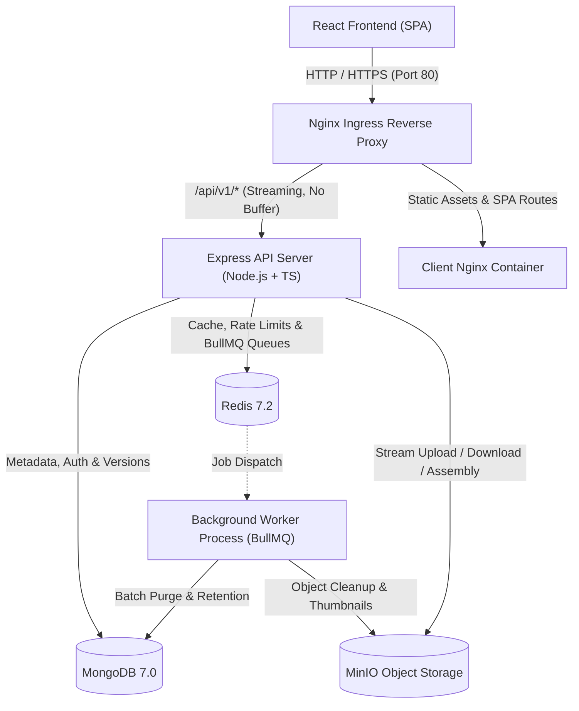
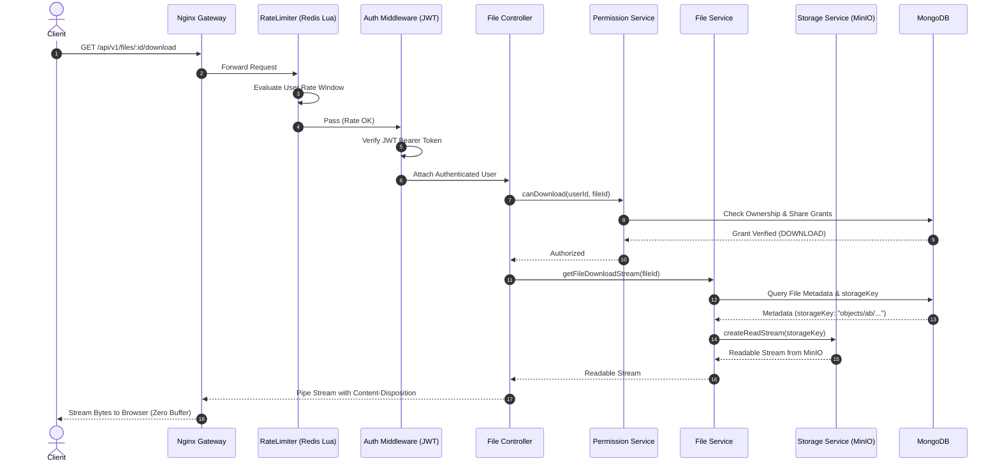
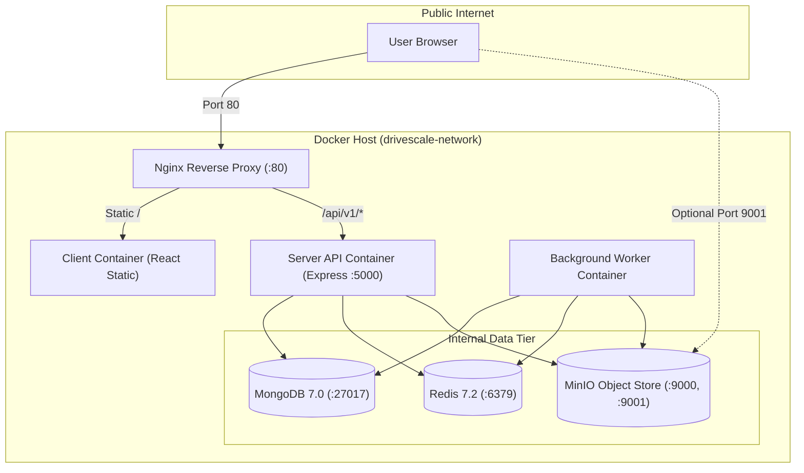

# DriveScale — Architecture Documentation

## 1. Architectural Philosophy

DriveScale is structured as a **modular monolith** with strict boundaries between HTTP controllers, domain business services, data repositories, and infrastructure adapters.



### Why a Modular Monolith?
DriveScale intentionally adopts a modular monolith rather than microservices for clear architectural and operational advantages:
1. **Self-Hosted Simplicity**: The primary project goal is self-hosted deployment on standard hardware or single-node VPS instances. A modular monolith deploys as a cohesive Docker Compose stack without the overhead of service meshes, distributed tracing networks, or multi-cluster orchestration.
2. **Zero Network Latency Between Domain Boundaries**: Cross-cutting features—such as authorization checking during file moves, quota reconciliation during upload assembly, and version snapshot creation—execute in-process with nanosecond latency rather than multi-hop RPC calls.
3. **Transaction Safety Without Distributed Sagas**: User quota reservation and upload session completion leverage MongoDB atomic document updates and atomic Redis Lua scripts without needing two-phase commits or complex saga compensating mechanisms.
4. **Shared Type System**: Full TypeScript monorepo ensures that schemas, DTOs, and interface contracts are shared end-to-end between client and server workspaces, eliminating payload drift.

---

## 2. High-Level Component Overview

| Component | Technology | Primary Responsibility |
|---|---|---|
| **Public Gateway** | Nginx 1.27 Alpine | Ingress reverse proxy, SSL termination ready, streaming zero-buffering proxy, static asset delivery, security headers. |
| **Frontend Client** | React 18/19, TypeScript, Vite | User interface, state management, 3-worker concurrent chunked upload orchestration, resumable upload recovery. |
| **API Server** | Node.js 20, Express, TypeScript | REST API endpoints, JWT authentication, permission verification, quota management, stream pipelines. |
| **Metadata Database** | MongoDB 7.0 (Mongoose) | User accounts, folder hierarchies, file metadata, version logs, permissions, active upload sessions. |
| **Cache & Queue Broker** | Redis 7.2 (ioredis) | Multi-tiered cache-aside layer, distributed atomic rate limiting, BullMQ job queue broker. |
| **Object Storage** | MinIO RELEASE.2024 (S3 API) | Scalable, self-hosted object storage holding raw file bytes under server-generated keys. |
| **Background Worker** | BullMQ, Node.js 20 | Asynchronous job execution (thumbnail generation, expired session cleanup, 30-day trash retention purge). |

---

## 3. Frontend Architecture

The frontend application (`client/`) is built with **React**, **TypeScript**, and **Vite**, organized into feature-driven modules:

```text
client/src/
├── components/
│   ├── ui/               # Reusable primitives (Buttons, Modals, Inputs, Badges, Dropdowns)
│   ├── layout/           # Navbar, Sidebar, Breadcrumb navigation, Layout wrapper
│   ├── file/             # FileTable, FileGrid, FileCard, FileContextMenu, FileDetailModal
│   ├── folder/           # FolderTree, FolderCard, CreateFolderModal, MoveFolderModal
│   ├── upload/           # UploadDropzone, UploadProgressTray, IncompleteUploadBanner
│   ├── sharing/          # ShareModal, ShareUserList, PermissionBadge
│   └── version/          # VersionHistoryDrawer, VersionItem, VersionRestoreModal
├── pages/                # Route targets (Login, Register, Drive, Shared, Recent, Trash, Settings)
├── hooks/                # Custom React hooks (useAuth, useDrive, useUpload, useDebounce)
├── services/             # Axios API clients (auth, file, folder, upload, share, version, trash)
├── stores/               # Zustand stores for reactive client state
│   ├── auth.store.ts     # User profile, access token, authentication status
│   ├── upload.store.ts   # Active upload progress, worker status, cancellation tokens
│   └── ui.store.ts       # Sidebar collapse, active view mode (grid vs table), theme
└── types/                # TypeScript interface definitions shared across client components
```

### State Management Strategy
1. **Server Cache State (TanStack Query)**:
   - Manages asynchronous remote data: folder contents, search results, trash items, share permissions, storage statistics.
   - Configured with automatic background refetching and targeted cache key invalidation on mutations (e.g. creating a folder immediately invalidates `['folders', parentId, 'children']`).
2. **Client Interaction State (Zustand)**:
   - Lightweight, unopinionated reactive stores for local UI state: selection sets, active modals, floating upload tray visibility, and authentication tokens.
3. **Form Handling & Validation (React Hook Form + Zod)**:
   - Performant, uncontrolled form inputs with schema-based validation for login, registration, and sharing dialogs.

---

## 4. Backend Architecture & Request Flow

The backend (`server/`) follows clean layered architecture principles where each layer has a single, strictly defined responsibility:



### Layer Responsibilities
1. **Routes (`routes/*.routes.ts`)**:
   - Versioned mount point under `/api/v1`.
   - Binds HTTP verbs and URI paths to controller actions.
   - Applies endpoint-specific middleware (validation, custom rate limits).
2. **Controllers (`controllers/*.controller.ts`)**:
   - Thin layer that extracts request parameters, headers, query parameters, and validated bodies.
   - Invokes domain services.
   - Formats responses using standardized JSON helpers (`sendSuccess`, `sendError`).
3. **Services (`services/*.service.ts`)**:
   - Encapsulates all business logic, workflow sequencing, and security rules.
   - Verifies authorization via `PermissionService` before any mutation.
   - Interacts with data repositories and external infrastructure (MinIO, Redis, BullMQ).
4. **Storage Service (`services/storage/`)**:
   - Decouples domain logic from MinIO S3 SDK primitives and filesystem paths through the `IStorageService` interface.
5. **Models (`models/*.ts`)**:
   - Defines Mongoose schemas with compound indexes, field validation, and soft-deletion flags.

---

## 5. Storage Subsystem & Abstraction

All file storage operations must conform to the `IStorageService` abstraction:

```typescript
export interface IStorageService {
  upload(key: string, stream: NodeJS.ReadableStream, size?: number, contentType?: string): Promise<{ size: number; checksum: string }>;
  download(key: string): Promise<Buffer>;
  createReadStream(key: string): Promise<NodeJS.ReadableStream>;
  delete(key: string): Promise<void>;
  exists(key: string): Promise<boolean>;
  getMetadata(key: string): Promise<StorageMetadata>;
  saveChunk(uploadId: string, chunkNumber: number, chunkStream: NodeJS.ReadableStream, expectedChecksum?: string): Promise<{ size: number; checksum: string }>;
  chunkExists(uploadId: string, chunkNumber: number): Promise<boolean>;
  deleteChunks(uploadId: string): Promise<void>;
  assembleChunks(uploadId: string, totalChunks: number, targetKey: string): Promise<{ size: number; checksum: string }>;
}
```

### Implementations
1. **`MinioStorageService`** (Default / Production):
   - Implements S3-compatible object storage via the official `@minio` client.
   - Uses server-generated storage keys with two-level prefix sharding (`objects/3a/3a8f...`) to prevent filesystem hot-spotting.
   - Strict path traversal defense: rejects any key containing `..`, null bytes (`\0`), or leading slashes.
   - Sequential assembly pipeline: streams temporary on-disk chunks sequentially into MinIO using an async generator without loading whole files into memory.
2. **`LocalStorageService`** (Fallback / Test Driver):
   - Directly streams files into a designated local directory (`data/storage/`).
   - Used for zero-dependency local testing and test isolation.

---

## 6. Redis Caching & Distributed Rate Limiting

### A. Caching Architecture
- **Strategy**: Cache-aside with automatic invalidation.
- **Namespaced Keys**: `drivescale:user:<userId>:folders:<id>:children`, `drivescale:user:<userId>:storage:stats`.
- **Zero File Byte Caching**: Only non-sensitive metadata and directory structures are cached. Raw file bytes and access tokens are never cached in Redis.
- **Resilience**: If Redis is offline, cache reads return `null` and gracefully fall back to MongoDB without throwing errors or interrupting requests.

### B. Distributed Rate Limiting
- **Atomic Lua Script**:
  ```lua
  local current = redis.call('INCR', KEYS[1])
  if current == 1 then
    redis.call('PEXPIRE', KEYS[1], ARGV[1])
  end
  local ttl = redis.call('PTTL', KEYS[1])
  return {current, ttl}
  ```
- **Windows and Limits**:
  - `authRateLimiter`: 10 requests / minute per client IP.
  - `uploadInitRateLimiter`: 20 sessions / minute per user ID.
  - `chunkUploadRateLimiter`: 120 chunks / minute per user ID.
  - `generalRateLimiter`: 100 requests / minute globally per user/IP (health check probes are explicitly skipped).
- **Fail-Safe Memory Fallback**: If Redis connectivity drops, the rate limiter falls back to an in-memory sliding window bucket per instance, preventing service disruption while maintaining defense against DoS attacks.

---

## 7. Background Worker Architecture (BullMQ)

Non-critical and compute-intensive operations are offloaded to BullMQ queues powered by Redis:

```text
Express API Server
       │
       ▼
 ┌────────────── BullMQ Producer Queues ─────────────┐
 │  • file-queue         (thumbnail generation)      │
 │  • cleanup-queue      (expired sessions & trash)  │
 │  • notification-queue (share activity events)     │
 └───────────────────────┬───────────────────────────┘
                         │ (Redis Streams)
                         ▼
             BullMQ Worker Process
               (server/src/worker.ts)
                         │
      ┌──────────────────┼──────────────────┐
      ▼                  ▼                  ▼
File Worker        Cleanup Worker     Notification Worker
• Sharp resize     • 24h upload purge • Share email alerts
• Preview commit   • 30d trash purge  • Push notifications
```

- **Process Isolation**: The worker runs as an independent OS process or Docker container, ensuring heavy image manipulation or batch deletions never degrade API latency.
- **Heartbeat & Liveness**: The worker writes periodic timestamp heartbeats to `/tmp/drivescale-worker-heartbeat`, verified by container health check probes via `worker-health.ts`.
- **Idempotency**: All jobs are idempotent and safe to retry on failure.

---

## 8. Production Containerization & Deployment

DriveScale deploys as a multi-container Docker Compose application configured with defense-in-depth networking:



### Zero-Buffering Streaming Configuration
Nginx is explicitly configured with `proxy_request_buffering off;` and `proxy_buffering off;`. This allows multi-gigabyte uploads and downloads to stream uninterrupted directly between the user's browser and MinIO through the Node.js stream pipeline without intermediate proxy disk spooling.
