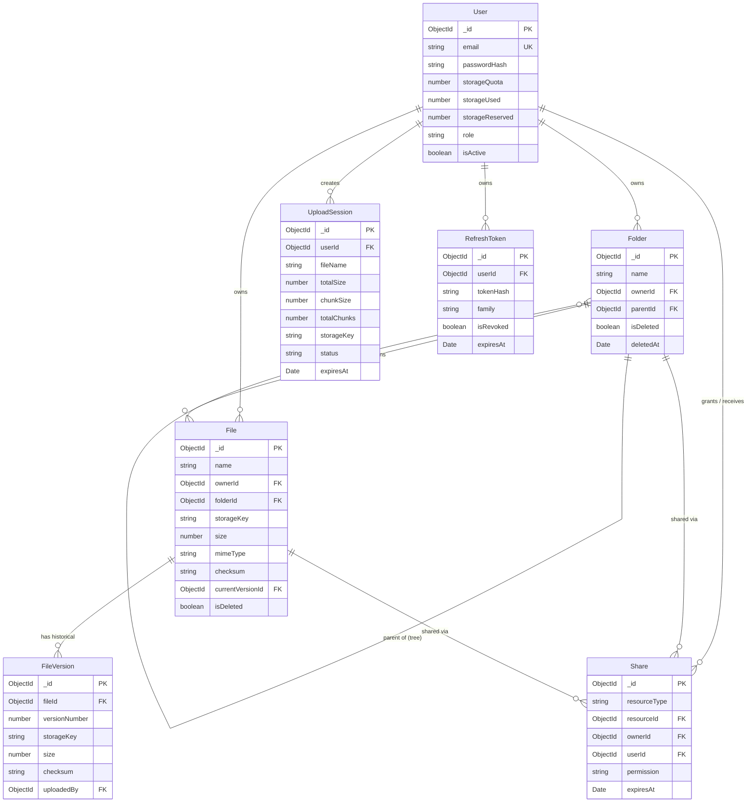

# DriveScale — Database Schema & Data Modeling

DriveScale utilizes **MongoDB** via Mongoose to store metadata, authentication states, directory structures, version catalogs, and upload sessions.

> [!IMPORTANT]
> **Separation of Bytes and Metadata**: Raw file bytes are never stored in MongoDB. The database stores metadata documents containing storage keys (`storageKey`) that reference object blobs in MinIO object storage.

---

## 1. Entity-Relationship Diagram

---

## 2. Model Schemas & Specifications

### A. `User` Model
Stores account credentials, profile details, and storage quota accounting.

| Field | Type | Default | Description |
|---|---|---|---|
| `_id` | `ObjectId` | Auto | Unique user identifier. |
| `name` | `string` | — | User's full display name. |
| `email` | `string` | — | Unique, lowercased email address used for login and sharing. |
| `passwordHash` | `string` | — | Secure Argon2id password hash. Plaintext passwords are never stored. |
| `avatar` | `string` | `null` | Optional profile image URL. |
| `storageQuota` | `number` | `10737418240` | Maximum allowed storage in bytes (default: 10 GB). |
| `storageUsed` | `number` | `0` | Sum of active file bytes currently stored. |
| `storageReserved`| `number` | `0` | Sum of bytes reserved by in-progress upload sessions. |
| `role` | `string` | `'user'` | Role-based access control (`'user'` or `'admin'`). |
| `isVerified` | `boolean` | `true` | Email verification flag. |
| `isActive` | `boolean` | `true` | Account active flag. Deactivated accounts are rejected (`403`). |
| `createdAt` | `Date` | Auto | Timestamp of account registration. |
| `updatedAt` | `Date` | Auto | Timestamp of last profile modification. |

**Indexes**:
- `{ email: 1 }` (Unique constraint)

---

### B. `Folder` Model
Represents directory nodes in the user's hierarchical filesystem tree.

| Field | Type | Default | Description |
|---|---|---|---|
| `_id` | `ObjectId` | Auto | Unique folder identifier. |
| `name` | `string` | — | Sanitized folder name. |
| `ownerId` | `ObjectId` | — | References owning `User`. |
| `parentId` | `ObjectId \| null` | `null` | References parent `Folder`. `null` designates user's root directory. |
| `isDeleted` | `boolean` | `false` | Soft-deletion flag. `true` indicates item is in trash. |
| `deletedAt` | `Date` | `null` | Timestamp when folder was moved to trash. |
| `deletedBy` | `ObjectId` | `null` | User who initiated the deletion. |
| `originalParentId`| `ObjectId \| null`| `null`| Preserved location for restoration if parent is permanently deleted. |
| `deletedWithFolderId`| `ObjectId \| null`| `null`| Tracks cascade deletion parent. |
| `createdAt` | `Date` | Auto | Creation timestamp. |
| `updatedAt` | `Date` | Auto | Last metadata modification timestamp. |

**Indexes**:
- `{ ownerId: 1, parentId: 1, name: 1, isDeleted: 1 }` (Unique constraint among active siblings)
- `{ ownerId: 1, isDeleted: 1, name: 1 }` (Compound search index)
- `{ isDeleted: 1, deletedAt: 1 }` (Background retention cleanup index)

---

### C. `File` Model
Stores metadata for uploaded objects.

| Field | Type | Default | Description |
|---|---|---|---|
| `_id` | `ObjectId` | Auto | Unique file identifier. |
| `name` | `string` | — | File display name including extension. |
| `ownerId` | `ObjectId` | — | References owning `User`. |
| `folderId` | `ObjectId \| null` | `null` | References parent `Folder`. `null` indicates root directory. |
| `storageKey` | `string` | — | Server-generated object key pointing to MinIO (`objects/xx/<hash>`). |
| `size` | `number` | — | File size in bytes. |
| `mimeType` | `string` | — | Validated MIME type (e.g. `application/pdf`, `image/png`). |
| `checksum` | `string` | — | Cryptographic SHA-256 hex digest of the file bytes. |
| `currentVersionId`| `ObjectId` | `null` | References active `FileVersion` snapshot. |
| `versionCount` | `number` | `1` | Total number of recorded versions. |
| `isDeleted` | `boolean` | `false` | Soft-deletion flag. |
| `deletedAt` | `Date` | `null` | Timestamp moved to trash. |
| `deletedBy` | `ObjectId` | `null` | User who soft-deleted the file. |
| `originalFolderId`| `ObjectId \| null`| `null`| Preserved folder location for restoration. |
| `deletedWithFolderId`| `ObjectId \| null`| `null`| References folder if deleted via cascade. |
| `createdAt` | `Date` | Auto | Creation timestamp. |
| `updatedAt` | `Date` | Auto | Last version update or rename timestamp. |

**Indexes**:
- `{ ownerId: 1, folderId: 1, name: 1, isDeleted: 1 }` (Unique constraint among active siblings)
- `{ ownerId: 1, isDeleted: 1, name: 1 }` (Search index)
- `{ storageKey: 1 }` (Object lookup index)
- `{ isDeleted: 1, deletedAt: 1 }` (Trash cleanup index)

---

### D. `FileVersion` Model
Maintains historical snapshots of modified or replaced files.

| Field | Type | Default | Description |
|---|---|---|---|
| `_id` | `ObjectId` | Auto | Unique version snapshot identifier. |
| `fileId` | `ObjectId` | — | References parent `File`. |
| `versionNumber` | `number` | — | Sequential 1-based version number (v1, v2, v3). |
| `storageKey` | `string` | — | Unique MinIO object key holding bytes for this specific snapshot. |
| `size` | `number` | — | Byte size of this version snapshot. |
| `mimeType` | `string` | — | MIME type of this version snapshot. |
| `checksum` | `string` | — | SHA-256 hex digest of this version snapshot. |
| `uploadedBy` | `ObjectId` | — | User who uploaded this replacement version. |
| `createdAt` | `Date` | Auto | Snapshot creation timestamp. |

**Indexes**:
- `{ fileId: 1, versionNumber: 1 }` (Unique constraint)

---

### E. `Share` Model
Controls access rights granted to other registered users.

| Field | Type | Default | Description |
|---|---|---|---|
| `_id` | `ObjectId` | Auto | Unique share grant identifier. |
| `resourceType` | `string` | — | Target type: `'FILE'` or `'FOLDER'`. |
| `resourceId` | `ObjectId` | — | References shared `File` or `Folder`. |
| `ownerId` | `ObjectId` | — | User granting the share. |
| `userId` | `ObjectId` | — | Recipient `User` receiving access. |
| `permission` | `string` | — | Access tier: `'VIEW'`, `'DOWNLOAD'`, or `'EDIT'`. |
| `expiresAt` | `Date` | `null` | Optional expiration date. Expired shares are automatically ignored. |
| `createdAt` | `Date` | Auto | Creation timestamp. |

**Indexes**:
- `{ resourceType: 1, resourceId: 1, userId: 1 }` (Unique grant constraint)
- `{ userId: 1 }` (Inbound share query index)
- `{ ownerId: 1 }` (Outbound share query index)

---

### F. `UploadSession` Model
Tracks the state of chunked, multi-part, and resumable uploads.

| Field | Type | Default | Description |
|---|---|---|---|
| `_id` | `ObjectId` | Auto | Unique upload session identifier. |
| `userId` | `ObjectId` | — | Uploader user identifier. |
| `replaceFileId` | `ObjectId \| null` | `null` | Target `File` ID if creating a replacement version. |
| `fileName` | `string` | — | Sanitized file name. |
| `folderId` | `ObjectId \| null` | `null` | Destination folder. |
| `mimeType` | `string` | — | File MIME type. |
| `totalSize` | `number` | — | Expected total file size in bytes. |
| `chunkSize` | `number` | — | Size per chunk in bytes (default: 5 MB). |
| `totalChunks` | `number` | — | Computed total number of chunks. |
| `uploadedChunks`| `Array` | `[]` | Array of `{ chunkNumber, size, checksum, uploadedAt }`. |
| `storageKey` | `string` | — | Pre-allocated MinIO target object key. |
| `reservedBytes`| `number` | — | Bytes atomically reserved against user quota. |
| `status` | `string` | `'PENDING'` | State: `'PENDING'`, `'UPLOADING'`, `'ASSEMBLING'`, `'COMPLETED'`, `'FAILED'`, `'EXPIRED'`, `'CANCELLED'`. |
| `expiresAt` | `Date` | Auto | 24-hour TTL after which session is invalid. |
| `createdAt` | `Date` | Auto | Session creation timestamp. |
| `updatedAt` | `Date` | Auto | Last chunk ingestion timestamp. |

**Indexes**:
- `{ userId: 1, status: 1 }` (Active session query index)
- `{ expiresAt: 1 }` (TTL expiration purge index)

---

### G. `RefreshToken` Model
Manages refresh token rotation and token reuse detection.

| Field | Type | Default | Description |
|---|---|---|---|
| `_id` | `ObjectId` | Auto | Unique token record identifier. |
| `userId` | `ObjectId` | — | References user account. |
| `tokenHash` | `string` | — | Cryptographic hash of the issued refresh token. |
| `family` | `string` | — | Family UUID grouping tokens across rotations. |
| `isRevoked` | `boolean` | `false` | Revocation flag. Used to detect token reuse attacks. |
| `expiresAt` | `Date` | Auto | Expiration timestamp (default: 7 days). |
| `createdAt` | `Date` | Auto | Token issuance timestamp. |

**Indexes**:
- `{ tokenHash: 1 }` (Lookup index)
- `{ userId: 1, family: 1 }` (Family revocation index)
- `{ expiresAt: 1 }` (TTL auto-cleanup index)
