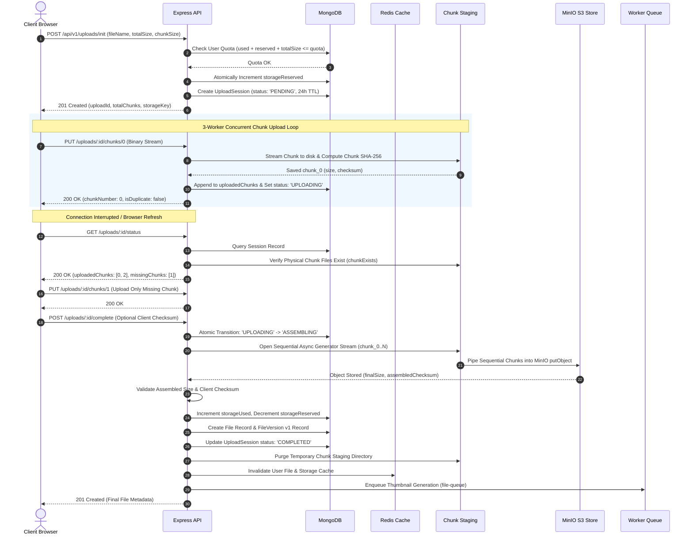

# DriveScale — Upload Subsystem Architecture

DriveScale implements an enterprise-grade, streaming upload architecture specifically engineered for high throughput and reliable large-file transfers over unstable networks.

Files are **never** buffered entirely into Node.js server memory. All byte transfers stream continuously through Node.js Streams and Transform pipelines directly into self-hosted MinIO object storage.

---

## 1. Upload Approaches Comparison

DriveScale provides two distinct upload strategies tailored to file size:

| Feature | Direct Streaming (`POST /files`) | Chunked & Resumable (`/uploads/*`) |
|---|---|---|
| **Target File Size** | Small to Medium (< 20 MB) | Large Files (Up to tens of GBs) |
| **Protocol** | Multipart/form-data via `busboy` | Sequential/Parallel HTTP chunks (`PUT`) |
| **Resumability** | No (must restart if disconnected) | Yes (transmits only missing chunks) |
| **Concurrency** | Single stream | Controlled client pool (3 workers) |
| **Memory Footprint** | Constant (~64 KB stream buffer) | Constant (one chunk at a time per worker) |
| **Integrity Checks** | Stream-level SHA-256 computation | Per-chunk SHA-256 + Assembled SHA-256 |
| **Quota Handling** | Checked upfront before stream pipes | Reserved upfront; reconciled at assembly |

---

## 2. End-to-End Sequence Diagram



---

## 3. Upload Lifecycle & State Machine

Upload sessions progress through strict, idempotent state transitions guarded by MongoDB atomic updates:

```text
                  +-----------------------------------+
                  |                                   |
                  v                                   |
+---------+     +------------+     +------------+     |
| PENDING | --> | UPLOADING  | --> | ASSEMBLING | ----+ (missing chunks detected)
+---------+     +------------+     +------------+
     |                 |                 |
     |                 |                 v
     |                 |          +-----------+
     |                 +--------> | COMPLETED |
     |                            +-----------+
     v                                  |
+-----------+                           |
| CANCELLED | <-------------------------+ (rejected: 400 SESSION_ALREADY_COMPLETED)
+-----------+
     ^
     |
+-----------+
|  EXPIRED  | (after 24-hour TTL)
+-----------+
```

### State Definitions & Inviolability Rules
1. **`PENDING`**: Session initialized with reserved quota; awaiting first chunk.
2. **`UPLOADING`**: One or more chunks have been ingested and verified on disk.
3. **`ASSEMBLING`**: Atomic transition initiated via `findOneAndUpdate({ status: { $in: ['PENDING', 'UPLOADING'] } }, { $set: { status: 'ASSEMBLING' } })`. Concurrent completion requests are safely rejected with `409 CONCURRENT_COMPLETION`.
4. **`COMPLETED`**: Chunks sequentially assembled into MinIO, SHA-256 confirmed, `File` document committed, reserved quota converted to `storageUsed`, and temporary chunk directory deleted. Repeated `/complete` calls on completed sessions idempotently return the existing `File` without re-assembly.
5. **`CANCELLED`**: Session manually aborted via `DELETE /uploads/:uploadId`. Temporary chunk directory is immediately purged and `storageReserved` is released. Completed sessions cannot be cancelled (`400 SESSION_ALREADY_COMPLETED`).
6. **`EXPIRED`**: Triggered when the 24-hour expiration threshold is crossed. Subsequent chunk uploads or completion attempts are rejected with `400 SESSION_EXPIRED`.

---

## 4. Chunk Ingestion & Validation Mechanics

### A. Dynamic Size Expectation
Every chunk (except the final one) must match the configured `session.chunkSize` exactly. The final chunk ($N-1$) must match the exact remaining bytes:
$$\text{Expected Final Size} = \text{totalSize} - (\text{totalChunks} - 1) \times \text{chunkSize}$$
Any chunk deviating from its expected size is rejected immediately (`400 INVALID_CHUNK_SIZE`) before disk persistence.

### B. Duplicate Chunk Idempotency & Conflict Detection
Networks frequently retry HTTP requests on timeout. DriveScale handles duplicate chunks safely:
- **Identical Duplicate**: If chunk $k$ is re-uploaded with the exact same SHA-256 checksum as the existing chunk on disk, the server returns `200 OK` (`isDuplicate: true`) without corrupting state or re-writing disk bytes.
- **Conflicting Duplicate**: If chunk $k$ is re-uploaded with differing content or checksum, the server rejects it with `409 Conflict` (`DUPLICATE_CHUNK_CONFLICT`) while preserving the original valid chunk intact.

### C. Out-of-Order Ingestion
Chunks arrive independently over 3 concurrent HTTP channels. The server saves each chunk under `chunk_<chunkNumber>` within the session directory. When assembly begins, the storage service streams chunks in strict numerical order ($0, 1, \dots, N-1$) regardless of arrival order.

---

## 5. Resumable Upload Workflow

### A. Physical Chunk Verification (`chunkExists`)
When a client queries `GET /api/v1/uploads/:uploadId/status`, the server performs physical integrity checks:
1. Iterates over all recorded `uploadedChunks`.
2. Verifies physical readability on disk via `storage.chunkExists(uploadId, chunkNumber)`.
3. If an on-disk chunk was deleted or corrupted, it is automatically pruned from the session record.
4. Returns sorted `missingChunks` calculated as:
   $$\text{missingChunks} = \{ i \in [0, \text{totalChunks}-1] \mid i \notin \text{verifiedChunks} \}$$

### B. Client-Side Resume Flow
1. **Metadata Storage**: When an upload starts, non-sensitive metadata (`uploadId`, `fileName`, `totalSize`, `folderId`, `createdAt`) is recorded in `localStorage`. File bytes are never stored in browser memory.
2. **Detection & Prompt**: Upon reconnecting or refreshing `Drive.tsx`, an "Incomplete Upload Found" banner is displayed.
3. **Resumption**: The user clicks "Resume Upload" and selects the local file. The client verifies name and size, queries `/status` for `missingChunks`, and uploads only the remaining chunks.

### C. Exponential Backoff Retry Strategy
Transient chunk upload network errors are retried with bounded exponential backoff:
- Max attempts: 3.
- Delay formula: $\text{delay} = 500 \text{ ms} \times 2^{(\text{attempt}-1)}$ (500ms, 1000ms, 2000ms).
- Fatal errors (`400`, `401`, `403`, `409`) fail fast without retrying.

---

## 6. Storage Tier Streaming Assembly

The streaming assembly pipeline in `MinioStorageService.assembleChunks` operates with constant memory:

```typescript
// Asynchronous generator yielding streams chunk-by-chunk
async function* streamChunks() {
  for (let i = 0; i < totalChunks; i++) {
    const chunkPath = path.join(chunksDir, uploadId, `chunk_${i}`);
    const chunkStream = fs.createReadStream(chunkPath);
    for await (const buffer of chunkStream) {
      yield buffer;
    }
  }
}

// Piped directly into MinIO putObject without buffering whole file in RAM
const readable = Readable.from(streamChunks());
await minioClient.putObject(bucketName, targetKey, readable);
```

Once the upload to MinIO completes successfully, all temporary chunk files are deleted immediately.
